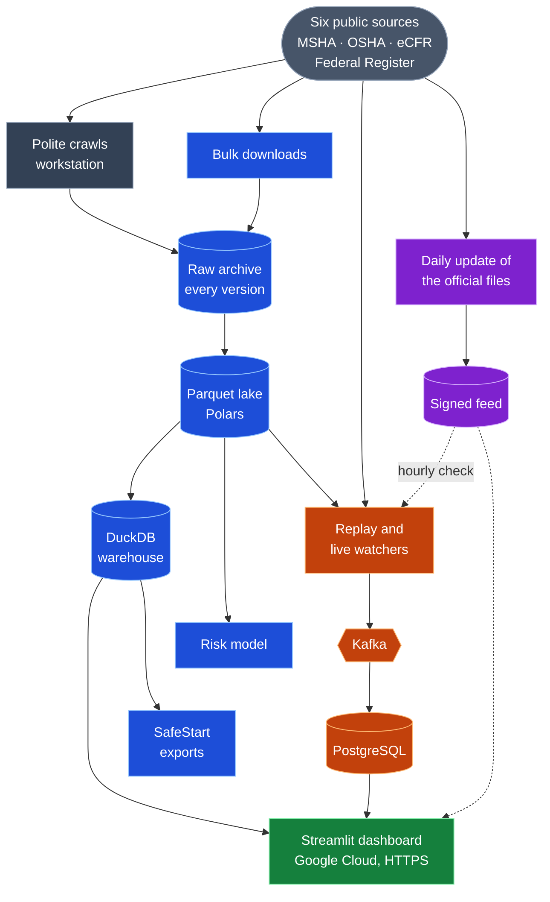

> [!IMPORTANT]
> **License: all rights reserved.** Copyright (c) 2026 Haiwei Yu. Course staff may view, download and run this
> repository to evaluate it; any other copying, redistribution, modification or commercial use needs the author's
> written permission. See [LICENSE](LICENSE).

<h1 align="center">SafeStart data pipeline</h1>

<p align="center">
  <picture>
    <source media="(prefers-reduced-motion: reduce) and (max-width: 600px)" srcset="docs/images/readme/hero-phone.svg#still">
    <source media="(prefers-reduced-motion: reduce)" srcset="docs/images/readme/hero.svg#still">
    <source media="(max-width: 600px)" srcset="docs/images/readme/hero-phone.svg">
    
  </picture>
</p>

<p align="center">
  <a href="https://github.com/USERZEROA/safestart-data-pipeline/actions/workflows/ci.yml"></a>
  <a href="https://35.254.13.119"></a>
  <a href="docs/SafeStart-data-pipeline-documentation.pdf"></a>
  <a href="https://github.com/USERZEROA/safestart-data-pipeline/commits/main"></a>
  <a href="LICENSE"></a>
</p>

<p align="center">
  <a href="https://cdn.jsdelivr.net/gh/USERZEROA/safestart-data-pipeline@040c348e2b6cff4d7327694fb644fc2b9808b844/docs/SafeStart-data-pipeline-video.mp4"></a>
</p>

<p align="center">
  <b>Video walkthrough</b>, 8 min 48 s:
  <a href="https://cdn.jsdelivr.net/gh/USERZEROA/safestart-data-pipeline@040c348e2b6cff4d7327694fb644fc2b9808b844/docs/SafeStart-data-pipeline-video.mp4">watch in the browser</a>
  or <a href="https://github.com/USERZEROA/safestart-data-pipeline/raw/main/docs/SafeStart-data-pipeline-video.mp4">
  download</a>
  &nbsp;·&nbsp; <b>Live dashboard</b>: <a href="https://35.254.13.119">35.254.13.119</a>, on Google Cloud
  &nbsp;·&nbsp; <b>Documentation</b>: <a href="docs/DOCUMENTATION.md">read it here</a>
  or <a href="docs/SafeStart-data-pipeline-documentation.pdf">as a PDF</a>
</p>

SafeStart helps mine crews prepare for a shift. This pipeline collects the public U.S. mine-safety record, keeps a
content-addressed archive of what it downloads and builds a DuckDB warehouse. It streams enforcement events through
Kafka into PostgreSQL, ranks mines by serious-accident risk and serves the results in a dashboard and files for
SafeStart.

> [!NOTE]
> Each time the stack starts, it replays enforcement history from 2024 onward. The November 23 build replayed 374,400
> events in about 90 minutes. Each event counts once, even after a restart. Watchers check the Federal Register and
> the signed feed hourly, MSHA's datasets and sitemaps every six hours, and OSHA's sitemap daily. The daily
> official-files update starts on the server at 16:30 UTC and publishes a [signed feed](https://35.254.13.119/feed/official/latest.json).
> Manifest 2 recorded 3 new and 12 changed files. Manifest 3 checked 3,904 pages with no changes. The video's dark
> Live view shows all seven event totals and lets you switch between historical replay and live discoveries.

## Course requirements

The [line-by-line rubric check](docs/evidence/rubric-check.md) records the evidence and the single-author
collaboration limitation.

| Requirement (points) | Where to look |
|---|---|
| Repository and collaboration (60) | Haiwei Yu is the sole contributor. [Contribution record](docs/evidence/rubric-check.md#repository-and-collaboration) |
| Data ingestion (40) | [How six public sources are collected][ingestion] |
| Data storage (40) | [Entity relationships](docs/ERD.md) for the warehouse and stream store |
| Data querying (40) | [Ten SQL questions and their answers](docs/QUERIES.md) |
| Transformation and analysis (40) | [Polars analysis and accident-risk model](docs/ML.md) |
| Architecture and orchestration (50) | [Batch tasks and logs][flow] from a real Prefect Cloud run |
| Containers, CI/CD and testing (60) | [CI workflow][ci] for lint, the test suite and the Docker Compose stack |
| Undercurrents of data engineering (60) | [Eight principles and their implementation][principles] |
| Additional components (60) | [Five dashboard views](docs/DOCUMENTATION.md#dashboard) with warehouse and stream data |
| Video and documentation (50) | 8 min 48 s walkthrough above and [12-page report][pdf] with a one-page summary |

[ingestion]: docs/DOCUMENTATION.md#sources-and-ingestion
[flow]: docs/evidence/prefect-run-2026-11-23.md
[ci]: .github/workflows/ci.yml
[principles]: docs/DOCUMENTATION.md#undercurrents-of-data-engineering
[pdf]: docs/SafeStart-data-pipeline-documentation.pdf

## Architecture



Gray shows the workstation crawls. In blue, Prefect runs the batch daily and the model every Sunday. Orange shows the
stream, purple the daily official-files update, and green the dashboard. The
[full diagram](docs/DOCUMENTATION.md#architecture) includes every store and flow.

<p align="center">
  
  
  
  
  
  
  
  
  
</p>

## Key numbers

<p align="center">
  <picture>
    <source media="(prefers-reduced-motion: reduce) and (max-width: 600px)" srcset="docs/images/readme/key-numbers-phone.svg#still">
    <source media="(prefers-reduced-motion: reduce)" srcset="docs/images/readme/key-numbers.svg#still">
    <source media="(max-width: 600px)" srcset="docs/images/readme/key-numbers-phone.svg">
    
  </picture>
</p>

Each reading comes from the **November 23, 2026 build**. The [batch run][flow] records the path from download to export.

| Board reading | Evidence |
|---|---|
| 6 public sources | [Acquisition method for each source][ingestion] |
| 84,602 files · 44.6 GB | [Archive counts and bytes by folder](docs/evidence/sources.md#raw-archive) |
| 18.1 M lake rows · 20 datasets · 40 versions | [Manifest and source-line counts](docs/evidence/lake.md) |
| 3.1 M violations · 1.2 M inspections · 276,013 accidents | [Exact row counts by dataset](docs/evidence/lake.md) |
| 10 SQL questions · 8 model tables · 5 marts | [Questions and answers](docs/QUERIES.md) · [warehouse schema](docs/ERD.md) |
| 374,400 events streamed | [Replay period and count](docs/DOCUMENTATION.md#streaming) |
| Test ROC AUC 0.909 · top 5% at 10× the base rate | [Held-out model evaluation](docs/ML.md) |
| 556 tests in the build · 590 collected on November 24 | [Build snapshot](docs/DOCUMENTATION.md#executive-summary) · [later test inventory](docs/DOCUMENTATION.md#testing-and-ci) |
| 5 dashboard pages | [Views and data sources](docs/DOCUMENTATION.md#dashboard) · [deployment](docs/DEPLOYMENT.md) |

## Team

A single-member team: **Haiwei Yu** designs, builds, tests, deploys and documents every part: ingestion, storage and
data modeling, transformation, streaming, machine learning, orchestration, the dashboard, containers, CI and the cloud
deployment.

## Quick start

Python 3.12 or later with [uv](https://docs.astral.sh/uv/), and Docker for the stack.

```bash
# the locked environment, then the tests
uv sync --all-extras
uv run pytest
# a 300 KB synthetic data root, and the whole stack on it
uv run python -m safestart_pipeline.sample sample-data
# on Linux the orchestrator writes as uid 10001
if [ "$(uname -s)" = Linux ]; then sudo chown -R 10001:10001 sample-data; fi
python scripts/start.py --data-root sample-data --with-orchestrator
# the warehouse and the exports, built inside the stack
docker compose exec orchestrator \
  python -m safestart_pipeline.flows run batch --no-download
```

The dashboard then runs at `http://localhost:8501`.

<details>
<summary><b>Build the real data yourself</b></summary>

```bash
# a website (also osha, then arlweb); state in <data root>/state
uv run ssp inventory msha && uv run ssp crawl msha
# is the copy complete and current?
uv run ssp verify msha --live
# bulk downloads, lake, warehouse, exports, then the model
uv run ssp pipeline --model
# one of the documented SQL questions
uv run ssp warehouse query top_cited_sections
```

The data root defaults to `./data`; `SAFESTART_DATA_ROOT` or `data_root` in `pipeline.local.toml` moves it.
[DEPLOYMENT](docs/DEPLOYMENT.md) covers the stack, its settings and the Google Cloud deployment step by step.

</details>

## Undercurrents of data engineering

| Principle | For example |
|---|---|
| Scalability | Streaming Parquet writes, DuckDB under memory limits, Kafka partitioned by mine |
| Modularity | Ten single-purpose packages that meet only at documented contracts |
| Reusability | One rule set, one record-to-event mapping, one image for every service |
| Observability | Every URL and failed cast accounted for, build checks, source checks, Prefect logs |
| Data governance | Files named by their SHA-256, every lake version kept, a dictionary of every column |
| Reliability | Atomic writes, writer locks, resumable crawls, retried flows, exactly-once counts |
| Efficiency | Conditional re-checks, unchanged versions never rebuilt, the stack in a 4 GB VM |
| Security | Secrets from the environment, unprivileged read-only containers, only HTTP(S) open |

## Documentation

| Document | What it holds |
|---|---|
| [DOCUMENTATION](docs/DOCUMENTATION.md) ([PDF][pdf]) | Executive summary, architecture, components and limits |
| [ARCHITECTURE](docs/ARCHITECTURE.md) | Packages, event contract, settings, stores |
| [ERD](docs/ERD.md) | Every table and column, the marts, the stream store |
| [QUERIES](docs/QUERIES.md) | Ten SQL questions with their real answers |
| [ML](docs/ML.md) | The accident-risk model, its guards and results |
| [OFFICIAL_FILES](docs/OFFICIAL_FILES.md) | The daily official-files update and the signed feed |
| [SAFESTART_EXPORTS](docs/SAFESTART_EXPORTS.md) | The files the pipeline hands SafeStart |
| [DEPLOYMENT](docs/DEPLOYMENT.md) | The stack and the Google Cloud deployment, step by step |
| [evidence/](docs/evidence/) | The records behind the headline figures |
