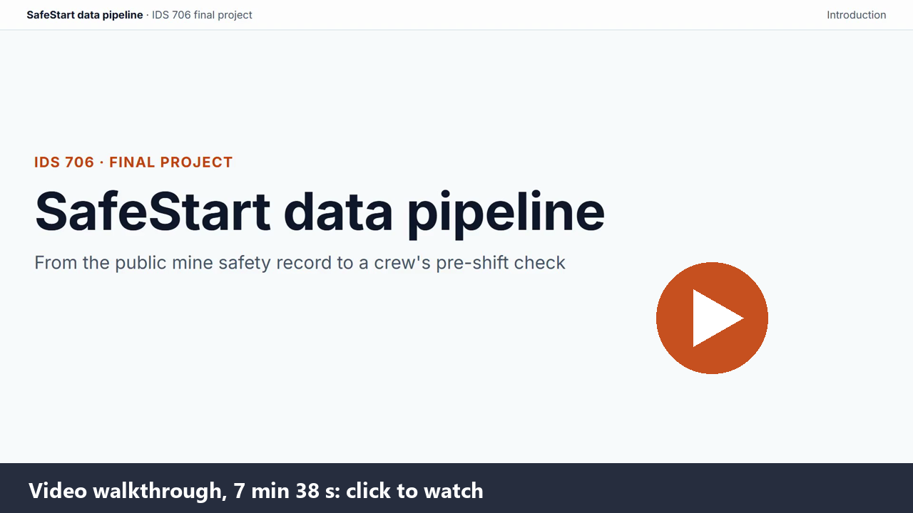
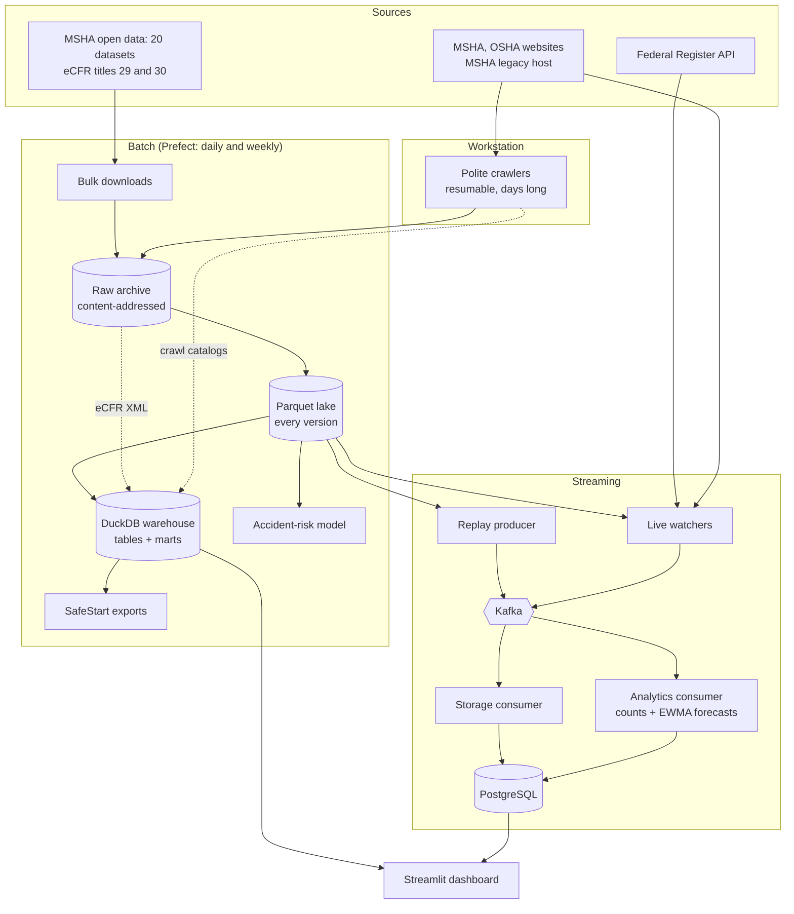
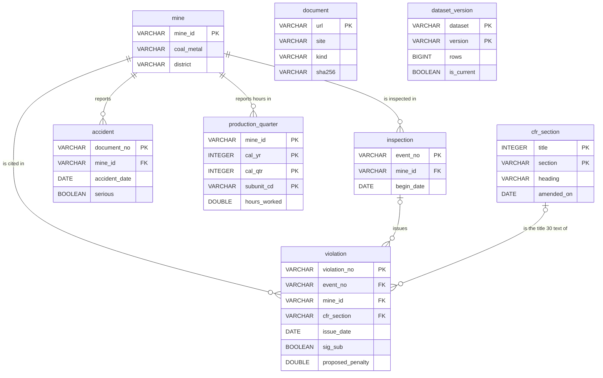
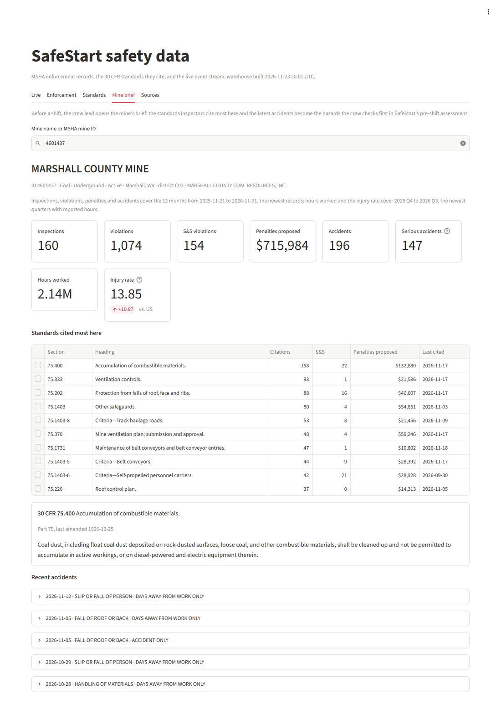
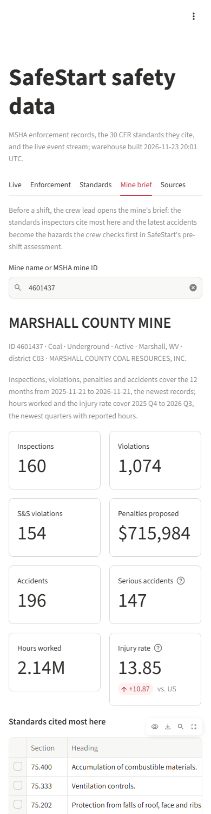
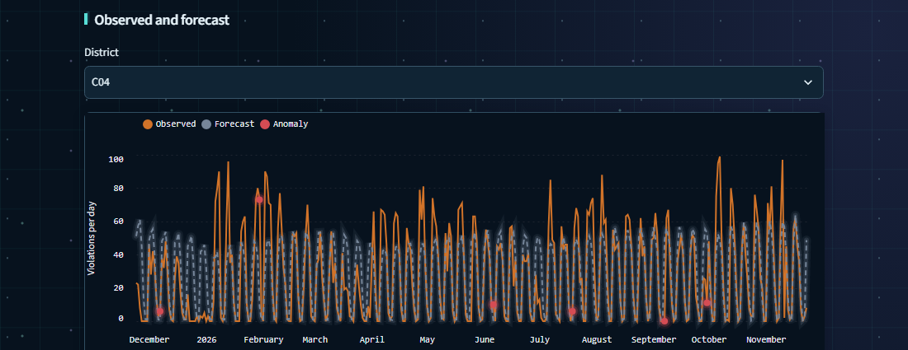

# SafeStart data pipeline

[](https://github.com/USERZEROA/safestart-data-pipeline/actions/workflows/ci.yml)

<table>
<tr>
<td width="44%" valign="top">
<a href="https://cdn.jsdelivr.net/gh/USERZEROA/safestart-data-pipeline@dbbe7820da447be395bf9fc096c7f91e5a6f76c3/docs/SafeStart-data-pipeline-video.mp4"></a>
</td>
<td valign="top">

**Video walkthrough** (8 min 6 s): it opens on a crew's pre-shift check in SafeStart, then follows the
pipeline's main flow: a real Prefect run, the lake, the warehouse, the model, the live stream and a mine's brief.
[Watch it in the browser](https://cdn.jsdelivr.net/gh/USERZEROA/safestart-data-pipeline@dbbe7820da447be395bf9fc096c7f91e5a6f76c3/docs/SafeStart-data-pipeline-video.mp4),
or [download the file](https://github.com/USERZEROA/safestart-data-pipeline/raw/main/docs/SafeStart-data-pipeline-video.mp4).

**Project documentation** (PDF, 10 pages): the executive summary, the architecture, the key components and their
implementation. [Open the PDF](docs/SafeStart-data-pipeline-documentation.pdf).

**Live deployment**: the dashboard at <https://35.254.13.119>, on Google Cloud and fed by the Kafka stream.

</td>
</tr>
</table>

## Executive summary

**Problem.** Mine crews start every shift with a hazard assessment (a JSA). The public record that should inform it is
large, scattered and moving: 3.1 million MSHA violation records, 276,013 accidents, the federal regulations they cite,
and tens of thousands of guidance pages on the MSHA and OSHA websites, republished in new versions every week or so.
SafeStart, the JSA application this pipeline serves, needs that record clean, current and comparable, down to one
mine.

**What was built.** This repository is SafeStart's data pipeline. It collects the public U.S. mine and workplace safety
record, keeps every version of it, models it into a warehouse, streams MSHA's enforcement events through Kafka as they
appear, and turns it into what a crew and an analyst need before a shift: which standards inspectors cite at a mine,
what its recent accidents were, how its record compares, and which mines are most likely to have a serious accident
next quarter.

It runs end to end on one small host: polite crawlers and bulk downloads feed a content-addressed raw archive, a
typed Parquet lake (Polars), a DuckDB warehouse with marts and documented SQL questions, a Kafka stream into PostgreSQL
with an anomaly forecaster, an accident-risk model, a Streamlit dashboard and flat exports for SafeStart, orchestrated
by Prefect, packaged with Docker Compose, tested in GitHub Actions and deployed on Google Cloud.

| Part | What it is (as of the 2026-11-23 build) |
|---|---|
| Sources | MSHA and OSHA websites, MSHA's legacy host, eCFR titles 29 and 30, MSHA's 20 open enforcement datasets, and the Federal Register API (live) |
| Raw archive | 84,602 content-addressed files, 44.6 GB, every version kept |
| Lake | 20 datasets, every downloaded version as typed Parquet (40 versions), 18,057,074 current rows |
| Warehouse | DuckDB: 8 model tables (plus 4 build-check tables), 5 marts, 10 named SQL questions; 3.1 million violations, 1.2 million inspections, 276,013 accidents |
| Stream | Kafka (2 topics) into PostgreSQL: a replay of 374,400 events from 2024 on, plus live watchers |
| Model | Serious-accident risk per mine and quarter: test ROC AUC 0.909; its riskiest 5% are ten times the base rate |
| Delivery | Streamlit dashboard (5 pages), SafeStart exports, Prefect flows on a schedule, Google Cloud VM behind HTTPS |
| Live | **<https://35.254.13.119>**: the dashboard served from the Google Cloud VM, fed by the live stream; Prefect Cloud runs its batch |
| Quality | 424 tests; CI runs lint and the tests against PostgreSQL, then the whole stack on a synthetic sample data root |

**Evidence.** [docs/evidence/](docs/evidence/) copies the counts behind the figures above out of the records they come
from, without local paths or ids: a real Prefect Cloud batch run, the newest completeness reports of the crawls and
the bulk downloads, a count of the raw archive and the 20 lake manifests.

**Documentation.** This README is the project documentation: the summary above, then the architecture, the key
components and their implementation; the PDF above is the same document, printed. The files in [docs/](docs/) are
reference appendices with the full detail of each part: [ARCHITECTURE](docs/ARCHITECTURE.md), [ERD](docs/ERD.md),
[QUERIES](docs/QUERIES.md), [ML](docs/ML.md), [SAFESTART_EXPORTS](docs/SAFESTART_EXPORTS.md) and
[DEPLOYMENT](docs/DEPLOYMENT.md).

## Contents

- **Overview:** [Team](#team) · [Architecture](#architecture) · [Quick start](#quick-start)
- **Key components and their implementation:** [Sources and ingestion](#sources-and-ingestion) ·
  [Storage](#storage) · [Querying](#querying) · [Transformation and analysis](#transformation-and-analysis) ·
  [Streaming](#streaming) · [Orchestration](#orchestration) · [Dashboard](#dashboard) · [Deployment](#deployment) ·
  [Testing and CI](#testing-and-ci)
- **Reflection:** [Undercurrents of data engineering](#undercurrents-of-data-engineering) ·
  [How it feeds SafeStart](#how-it-feeds-safestart) · [Limits](#limits) · [Repository layout](#repository-layout)

## Team

A single-member team: Haiwei Yu designs, builds, tests, deploys and documents every part (ingestion, storage and data
modeling, transformation, streaming, machine learning, orchestration, the dashboard, containers, CI and the cloud
deployment).

## Architecture



The batch side keeps a faithful, versioned copy of the sources and rebuilds what depends on them; the streaming side
turns the same records into events with one contract (`stream/events.py`), so a replayed record and the same record
found live by a watcher are the same event. [docs/ARCHITECTURE.md](docs/ARCHITECTURE.md) has the packages, the event
contract, the settings and the stores.

## Quick start

Requirements: Python 3.12 or later with [uv](https://docs.astral.sh/uv/), and Docker for the stack.

```bash
uv sync --all-extras          # the environment, from uv.lock
uv run pytest                 # the tests (TEST_DATABASE_URL=postgresql://... adds the PostgreSQL ones)
```

Run the whole system (Kafka, PostgreSQL, the consumers, the replay, the watchers and the dashboard) with Docker Compose:

```bash
python scripts/start.py --data-root <folder with lake/ and warehouse/>   # writes .env, builds, starts, waits
uv run --extra stream python scripts/smoke_test.py                      # events through Kafka into PostgreSQL
```

The dashboard then runs on your own machine at `http://localhost:8501` (`DASHBOARD_HOST_PORT` in `.env` moves it;
the copy already running in the cloud is at <https://35.254.13.119>). `--with-orchestrator` also starts the
Prefect orchestrator, which runs the batch flows on their schedules and writes the data root.

Without the real data root (the stack reads about 4.5 GB of it: the bulk files, the crawl state, the lake and the
warehouse), try it on a small synthetic one, the root CI runs the whole stack on
([docs/DEPLOYMENT.md](docs/DEPLOYMENT.md#without-the-data-the-sample-data-root)):

```bash
uv run python -m safestart_pipeline.sample sample-data   # about 300 KB: two versions of five datasets, eCFR, a catalog
sudo chown -R 10001:10001 sample-data                     # Linux only: the orchestrator writes as uid 10001
python scripts/start.py --data-root sample-data --with-orchestrator
docker compose exec orchestrator python -m safestart_pipeline.flows run batch --no-download   # warehouse and exports
```

Build the data yourself (each step is resumable and polite to the sources):

```bash
uv run ssp inventory msha && uv run ssp crawl msha     # a website (also osha, then arlweb); state in <data root>/state
uv run ssp verify msha --live                          # is the copy complete and current?
uv run ssp pipeline --model    # bulk downloads, lake, warehouse, SafeStart exports, then the model (Prefect flows)
uv run ssp warehouse query top_cited_sections          # one of the documented SQL questions
```

The data root defaults to `./data`; `SAFESTART_DATA_ROOT` or `data_root` in `pipeline.local.toml` moves it.
[docs/DEPLOYMENT.md](docs/DEPLOYMENT.md) covers the stack, its settings and the cloud deployment step by step.

## Sources and ingestion

| Source | How it is acquired | Inventory |
|---|---|---|
| MSHA website (`www.msha.gov`) | crawl | sitemaps, then links |
| MSHA legacy host (`arlweb.msha.gov`) | crawl | the links the MSHA crawl recorded to it (the host has no home page, sitemap or directory listings) |
| OSHA website (`www.osha.gov`) | crawl | sitemaps, then links |
| eCFR titles 29 and 30 | bulk download of the govinfo XML (eCFR's own full-text API is closed to robots) | fixed list |
| MSHA open enforcement datasets | bulk download, every version kept | the open-data page's links |
| Federal Register | its public API, MSHA and OSHA documents (live watcher) | newest first |

The crawls recorded 56,104 OSHA, 32,507 MSHA and 13,859 legacy-host URLs and downloaded 41,157, 32,205 and 12,394
of them; the raw archive holds their 84,539 distinct files (10.9, 5.9 and 26.5 GB) and the 63 bulk files (1.3 GB),
44.6 GB in all. Every request follows the host's rules:

- `robots.txt` (RFC 9309), its `Allow`/`Disallow` patterns and its `Crawl-delay`: OSHA asks for 10 seconds between
  requests and excludes every URL with a query string; MSHA sets no delay, so the crawler waits 1 second. Redirect hops
  are paced and checked like any request.
- One request at a time per host, a product-token User-Agent, conditional requests on re-checks, and backing off on
  `429`/`503` and on repeated `403` responses. A refusal is never worked around.
- Every URL the crawler learns of, from a sitemap, a page link, a redirect or the project's own seed lists, ends
  in a recorded state: fetched (with
  its SHA-256), unchanged, redirect, not found, error after retries, or skipped with a reason (robots, page asset, query
  string, size limit, alias of another URL, not needed by the project, or excluded because another source downloads
  it).
- Each URL has one spelling (RFC 3986): lower-case host, no fragment or default port, escaped unreserved characters
  decoded and the remaining escapes in upper case; on OSHA, Drupal's `/index.php/<path>` is the page at `/<path>`.
- Copies are complete: documents, images, audio and video are kept; a file is skipped only above 2 GB or an hour of
  download, and `ssp fetch <site> <url> --max-mb <n>` downloads such a file on its own under the same rules.
- Since 2026-11-21 the OSHA crawl leaves out what the project does not use, recorded as skipped "not needed" so it can
  be queued again: pictures, sound, video and e-book copies of publications, copies in other languages, partnership,
  success-story and grant pages, advisory-committee records, OSHA's web copy of CFR text (the bulk eCFR is complete),
  paragraph-level interlinking pages, cancelled directives listed only in the archive, the month pages of the press
  archive and the yearly federal evaluations of State Plans. Interpretations, directives, Federal Register notices,
  publications, topic pages, news and data files are all downloaded.

`ssp verify <site>` reports whether a crawl is complete: every URL in a final state, every file on disk with its
recorded size (`--rehash` recomputes each SHA-256), where redirects and outside links lead, and with `--live` whether
today's sitemaps still match the inventory. `ssp verify bulk` checks every bulk file's hash and format, and with
`--live` compares the open-data page and each eCFR title section by section with the official eCFR structure. Each run
writes its report to `<data root>/reports/`.

## Storage

| Store | Holds | Why this store |
|---|---|---|
| Raw archive (`raw/<site>/objects/ab/cd/<sha256>`) | every downloaded file, named by its SHA-256 | a file reached under many URLs is stored once; a file's name proves its content |
| Crawl and bulk state (SQLite, `state/`) | one row per URL or bulk file and version, with its outcome | resumable runs, provenance, completeness checks |
| Lake (Parquet, `lake/msha_ogd/`) | every version of the 20 MSHA datasets, typed, one file per source version | columnar, compressed, versioned history for Polars and DuckDB |
| Warehouse (DuckDB, `warehouse/safestart.duckdb`) | the analytical model: 8 tables and 5 marts | fast SQL scans of millions of rows without a server on a 4 GB host |
| Stream store (PostgreSQL, schema `stream`) | events, exactly-once counts, forecasts, source checks ([its ERD](docs/ERD.md#stream-store-postgresql)) | concurrent writers (the consumers and the watchers) and transactional upserts |

**Lake.** `ssp lake` turns every downloaded version of each MSHA dataset into typed Parquet under
`<data root>/lake/msha_ogd/<dataset>/`, one file per source version named after the zip's SHA-256, so a rebuild of an
unchanged version does nothing, every row traces back to the exact file it came from, and consecutive versions can be
compared; the newest is the dataset's `current` one in its `manifest.json`.

- Reading: each file is pipe-delimited Windows-1252 text, decoded to UTF-8. MSHA wraps text in double quotes but never
  escapes a quote inside it (`"54" ROLL CR. #4"`) and one contractor name holds the separator, so a quote-honoring CSV
  reader runs records together (it kept 41,410 of the 92,129 mine records). Every record is one line: the lake splits
  each line itself, and a line that still does not give the header's fields fails the version instead of shifting
  values between columns. For every version, source lines = manifest rows = Parquet rows (checked for all 40).
- Types: every column is cast to the type MSHA's definition file declares; where the data contradicts it, an override
  with its reason is recorded in the manifest and in `_dictionary.parquet`, the data dictionary of every column.
- Cleaning: spaces and Excel's leading tabs are trimmed, MSHA's unknown-value markers become nulls, and a value that
  does not parse becomes a null counted per column in the manifest. A version is rebuilt when the lake format, the
  definition file or a type override changes.

**Warehouse.** `ssp warehouse build` loads the current lake versions, the eCFR text of titles 29 and 30 and the three
crawl catalogs into `mine`, `inspection`, `violation`, `accident`, `production_quarter`, `cfr_section`, `document` and
`dataset_version`, with primary keys, and builds the marts as views. It builds into a new file and swaps it in, so
readers never see a half-built warehouse, and it records what it found in `build_check` (repeated keys, rows without a
key, dangling references, citations of sections no longer in Title 30) rather than hiding it. The ERD and every table
are in [docs/ERD.md](docs/ERD.md).



The core tables and their keys (the build checks every reference it does not declare; every column, the marts and the
build's checks are in [docs/ERD.md](docs/ERD.md)). `document` and `dataset_version` describe the crawled corpus and
the lake versions the warehouse was built from.

**Shared definitions.** One module, [`definitions.py`](src/safestart_pipeline/definitions.py), states the rules every
component counts by: a serious accident is degree of injury 01 to 05 by its code, an injury 01 to 06, a violation's
cited section is the section its citation names without the paragraph, and a record's commodity is its mine's. The
warehouse, the stream, the watchers, the model and the dashboard all use it, so a number means the same everywhere.

## Querying

Ten SQL files in `src/safestart_pipeline/warehouse/queries/` each answer one question and say why it matters, for
example: which standards inspectors cite most (75.400, combustible accumulations, 148,461 times), how the share of
significant-and-substantial (S&S) violations moved (coal 41.6% in 2000, 19.0% in 2026), the injury rate per 200,000
hours by year, which accidents killed miners in the last ten years, the penalty per S&S violation by district, and
which mines' violations rose the most. Each runs in under 0.2 seconds:

```bash
uv run ssp warehouse query                        # the questions
uv run ssp warehouse query riskiest_active_mines  # one answer, as a Markdown table
```

The five marts (`mart_top_cited_sections`, `mart_mine_scorecard`, `mart_ss_trend`, `mart_injury_rate`,
`mart_district_year`) feed the dashboard and the exports. [docs/QUERIES.md](docs/QUERIES.md) has every question, its
SQL file and its real result.

## Transformation and analysis

The lake build is a Polars pipeline; the analysis and the model read it with Polars lazy scans.

- `ssp ml analyze` writes three tables from the lake: S&S share by year and commodity, the injury rate per 200,000
  hours, and the most cited sections.
- `ssp ml train` builds a mine-quarter panel (1,434,710 rows, 2001 to 2026) whose features come only from the four
  quarters before each quarter (inspections, violations, S&S violations, penalties, distinct cited sections, accidents,
  serious accidents, hours worked, employees, commodity, mine type, state, district) and whose target is a serious
  accident in the quarter itself. It splits by time (train to 2021, validate 2022, test 2023 and 2024), compares a
  logistic-regression baseline with histogram gradient boosting, and scores every mine for the open quarter.

On the test quarters the selected gradient boosting reaches ROC AUC 0.909 and PR AUC 0.478; of the 5% of mine-quarters
it ranks riskiest, 43% had a serious accident, ten times the 4.2% base rate. [docs/ML.md](docs/ML.md) has the leakage
guards, the calibration, the feature importances and the limits. These figures are the training run's own output,
published as [docs/ml/metrics.json](docs/ml/metrics.json) and
[docs/ml/permutation_importance.csv](docs/ml/permutation_importance.csv): `ssp ml train` wrote them on 2026-11-23
from that day's MSHA files, and [docs/ML.md](docs/ML.md#the-published-run-docsml) says how to reproduce them.

## Streaming

Two Kafka topics carry one validated event envelope (`stream/events.py`): `msha.enforcement` (inspections, violations,
107(a) imminent-danger orders and accidents, keyed by mine) and `safety.sources` (new dataset versions, website page
changes, Federal Register documents). The `event_id` is the source's own key, so every step is idempotent.

- The replay producer sends the enforcement history from the lake in source-time order on a source clock (5 seconds per
  source day by default: 374,400 events from 2024 to 2026 in about 90 minutes), month by month in flat memory.
- The live watchers compare each new dataset version with the one before (only new records become events), read MSHA's
  and OSHA's sitemaps against the crawl inventories for added, changed and dropped pages, and ask the Federal Register
  API for new MSHA and OSHA documents, each on its own schedule and under the same robots.txt rules as the crawls (and
  never while that site's crawl is writing). The replay and the version watcher share one record-to-event mapping
  (`stream/records.py`).
- The storage consumer stores each event once in PostgreSQL; the analytics consumer keeps daily counts per kind and
  district exactly once (a ledger of counted events), and forecasts each day one step ahead with an exponentially
  weighted average of the same weekday over 26 weeks, flagging days more than three scales above or below it (the
  weighted standard deviation, at least a Poisson count's and at least 1). Offsets are committed only after the
  database commit, so a crash replays a batch instead of losing it.
- The forecasts' clock follows the replay: each replayed event carries the last day of its pass, live events found
  meanwhile are counted at once but forecast only when the replay has passed their days, and after the pass the live
  days move the clock, so the days the watcher finds are forecast and judged as soon as they are complete.

## Orchestration

Prefect runs the batch side as flows of retried, logged tasks (`src/safestart_pipeline/flows/`): every day at 14:00 UTC
the bulk downloads, the lake, the warehouse and the SafeStart exports; every Sunday at 15:00 UTC the model and the
analysis tables. A failed step lets the later ones run on what is held wherever that is sound (a failed download keeps
the copy already held), and the run is marked failed at the end. `python -m safestart_pipeline.flows serve` serves both
flows as Prefect Cloud deployments when `PREFECT_API_URL` and `PREFECT_API_KEY` are set, and otherwise keeps the same
schedule in its own process; `ssp pipeline` runs them once.

The crawls stay outside Prefect on purpose: they run for days on a workstation, resumable and paced by each site's crawl
delay, and feed the raw archive the flows read. Delivery is manual by design: CI tests every push, and the cloud server
takes a new `main` when it is stopped and started (docs/DEPLOYMENT.md).

## Dashboard

`src/safestart_pipeline/dashboard/` is a Streamlit app over the warehouse (read-only) and the stream store, usable on a
phone:

- **Live**: counters by kind and the newest events, refreshed every five seconds;
- **Enforcement**: daily counts by kind and district, observed against forecast, with the flagged anomalies;
- **Standards**: the most cited sections with their text, and the S&S trend;
- **Mine brief**: SafeStart's view of one mine (search by name or MSHA ID): its 12-month record against the national
  injury rate, the standards cited most there with their text, and its recent accidents;
- **Sources**: every dataset's versions, the downloaded corpus by site and kind, and the freshness of each live check.

The mine brief of one of the largest underground coal mines, as the live dashboard serves it (desktop and phone):

<table><tr>
<td></td>
<td></td>
</tr></table>

The Enforcement page while the replay streams 2024: one district's violations each day against the one-step-ahead
forecast, which has learned the weekly rhythm of inspections (days it flags, when the window has any, are marked in
red):



## Deployment

One image runs every pipeline service; `docker-compose.yml` adds Kafka (KRaft, small heap) and PostgreSQL, with memory
limits that fit a 4 GB e2-medium. Every pipeline service runs as an unprivileged user without Linux capabilities and
mounts the data root read-only, except the orchestrator, the one writer of the data root. On Google Cloud,
`deploy/gcp/create-vm.sh` creates the VM, a reserved address, a firewall that admits only HTTP and HTTPS, and a service
account that can only read the data bucket; at boot `deploy/gcp/startup.sh` adds swap, installs Docker, copies the data
it lacks from the bucket and starts the stack with Caddy serving HTTPS. [docs/DEPLOYMENT.md](docs/DEPLOYMENT.md) has the
steps and a cost estimate.

It runs that way now: an e2-medium in us-central1 serves the dashboard at <https://35.254.13.119> with a Let's Encrypt
certificate for the address, the replay and the live watchers feed its stream, and its orchestrator serves the daily
batch and the weekly model as Prefect Cloud deployments.

## Testing and CI

`uv run pytest` runs 424 tests: each package against small fixtures (synthetic lake versions, crawl stores, eCFR XML,
HTTP mocks of the sources), the PostgreSQL consumers against a real database when `TEST_DATABASE_URL` is set, the flows
under a temporary Prefect API, the dashboard pages through Streamlit's AppTest on a warehouse the real build made, and
the deployment files themselves (memory budget, mounts, users, the cloud scripts against a stand-in gcloud).

The GitHub Actions workflow (`.github/workflows/ci.yml`) tests the parts, then the whole system:

- `test`: ruff, and the whole suite against a PostgreSQL service;
- `stack`: builds the image, writes the synthetic sample data root (`python -m safestart_pipeline.sample`), starts every
  service on it, runs the batch flow in the orchestrator (lake, warehouse, SafeStart exports), the replay and the
  version watcher, then checks the events by mode and kind, the daily counts and the version check in PostgreSQL, the
  warehouse's tables, the export files against their manifest, the dashboard's health, and sends contract events
  through Kafka into PostgreSQL with `scripts/smoke_test.py`.

## Undercurrents of data engineering

**Scalability.** Every heavy step streams instead of loading datasets whole: the lake transcodes line by line and
writes Parquet through Polars' streaming sink; the warehouse and the watchers query Parquet through DuckDB under an
explicit memory limit (1 GB for the build, 256 MB for the version watcher); the replay sorts one month at a time
(under 170 MB for 374,400 events). Kafka partitions enforcement events by mine across consumer groups that scale by
partition: storage is idempotent on `event_id`, and the analytics consumer stays exact even with a second instance,
since an advisory lock serializes its transactions (one instance is the configured default).

**Modularity.** Each stage is a package with one job and a narrow interface (`crawl`, `acquire`, `lake`, `warehouse`,
`stream`, `watch`, `ml`, `dashboard`, `flows`) and runs on its own (`ssp <command>` or `python -m <package>`). Stages
meet only at documented contracts: the lake's manifests, the warehouse's tables and views (docs/ERD.md), the event
envelope (`stream/events.py`) and the export files (docs/SAFESTART_EXPORTS.md).

**Reusability.** One rule set (`definitions.py`) serves DuckDB SQL, Polars and Python; one record-to-event mapping
(`stream/records.py`) serves the replay and the live watcher; the robots.txt client (`crawl/robots.py`) serves the
crawlers, the bulk downloads, the completeness checks and the watchers; one Docker image runs every pipeline service.

**Observability.** Nothing is dropped silently: every URL ends in a recorded state with a reason, the lake's manifests
count the lines read each way, the decoding and every failed cast per column, the lake build logs each dataset's
outcome, the warehouse records its checks in `build_check`, every repeated key in `duplicate_row` and every row without
a key in `null_key_row`, a failed request in a live completeness check is reported without losing the rest of the
report, each live check writes a row to `stream.source_checks` (shown on the dashboard's Sources page), Prefect keeps
every flow and task run with its logs, and `scripts/smoke_test.py` proves the stream end to end.

**Data governance.** Every lake file is named after the SHA-256 of the source file it came from and its manifest names
that file, when it was first seen and its Last-Modified date; events carry their dataset and version; the warehouse
records its sources in `dataset_version` and `build_info`, and the exports' manifest carries the lake versions, the
eCFR editions and file hashes. Every version of every source is kept. `_dictionary.parquet` documents every column with
MSHA's own description, and each type override states its reason. The crawls follow each site's robots.txt and pacing,
and what is left out is recorded with a reason. Only public data is collected, and the cloud bucket is private.

**Reliability.** Writes are atomic (a temporary file renamed into place for every lake file, manifest, warehouse and
export); one writer lock on the data root keeps a second batch, model or lake run out, and another keeps one warehouse
writer at a time; crawls and downloads resume from their state, and a failed download keeps the verified copy in use;
flows retry their tasks, let later steps run on held data, and the local scheduler retries a run that fails to start; a
version that cannot be read correctly fails loudly rather than shifting values; the stream commits Kafka offsets after
the database commit and counts each event exactly once across replays and restarts; Compose restarts services and checks
their health; the cloud data copy never overwrites or deletes.

**Efficiency.** Re-checks are conditional requests (unchanged files cost a 304), an unchanged lake version is never
rebuilt (a full lake check takes under a second), the lake keeps 40 versions of 20 datasets in 0.84 GB of Parquet, Kafka
compresses with lz4, the model trains in under two minutes with two threads in the image, and the whole stack fits a 4
GB VM (about 600 MB at rest).

**Security.** Secrets come only from the environment: `scripts/start.py` writes a random database password into a
private `.env` that git ignores. The pipeline's own containers run as uid 10001 without Linux capabilities and with
`no-new-privileges`, and all but the orchestrator mount the data root read-only; Kafka and PostgreSQL run their official
images, reachable only on 127.0.0.1, and the Caddy gateway, the one service listening beyond the host, keeps only the
capability to bind ports 80 and 443. On
Google Cloud the firewall admits only HTTP and HTTPS, the bucket is private with public access prevented, and the VM's
service account may only read that bucket. The dashboard opens its stores read-only with statement timeouts and
escapes what it displays.

## How it feeds SafeStart

SafeStart is a separate application and stays unchanged: the pipeline hands it two flat Parquet files and a manifest
(`ssp warehouse export`, [docs/SAFESTART_EXPORTS.md](docs/SAFESTART_EXPORTS.md)):

- `mine_profiles.parquet` (92,129 mines): each mine's 12-month record and its most cited sections with their headings,
  so a crew's pre-shift assessment can open with the hazards inspectors find most at that mine;
- `cited_sections.parquet` (1,789 sections): every cited standard with its counts, its S&S share and its current text,
  so SafeStart's regulation library can put the most cited standards first and flag cited sections no longer in force;
- `manifest.json`: row counts, file hashes and the exact source versions, so an importer can check what it loads.

## Limits

- MSHA publishes its datasets with a lag: the newest days of a version are incomplete, so the newest days' counts are
  low until the next version arrives.
- The model ranks mines by recorded history; it knows nothing a dataset does not record (conditions, staffing) and is a
  screening aid, not a prediction of any one accident.
- OSHA's sitemap gives no modification dates, so the OSHA watcher finds added and dropped pages only.
- From the cloud VM, MSHA's site answers the request for its sitemap (`https://www.msha.gov/sitemap.xml`) with an
  HTML page instead of the sitemap, while a workstation gets the XML, so the hosted watcher records
  `sitemaps-msha` as refused and finds no MSHA page changes there; a refusal is never worked around.
- govinfo's eCFR bulk files can trail eCFR: on 2026-11-23 title 29 was amended to 2026-11-09 while eCFR showed
  2026-11-10, so `ssp verify bulk --live` reports it as not complete until govinfo publishes a newer file.
- 238 OSHA URLs answered 403 (90 of them pages the project needs) and are recorded as such; a refusal is never
  worked around.
- MSHA writes some quotes inside text doubled (`4"" x 3""`); the lake keeps text as MSHA wrote it, so 14,278 accident
  narratives show doubled quotes.

## Repository layout

```
src/safestart_pipeline/   crawl, acquire, lake, warehouse, stream, watch, ml, dashboard, flows,
                          definitions, sample, cli
tests/                    pytest suite (fixtures only; never the real data root)
docs/                     ARCHITECTURE, ERD, QUERIES, ML, SAFESTART_EXPORTS, DEPLOYMENT; ml/ (the published
                          model metrics), evidence/ (the records behind the summary figures)
deploy/                   Caddyfile and the Google Cloud scripts
scripts/                  start.py (Compose launcher), smoke_test.py, crawl start/stop for Windows
```

## License

Copyright (c) 2026 Haiwei Yu. All rights reserved. Course staff may view, download and run this repository
to evaluate it; any other copying, redistribution, modification or commercial use needs the author's written
permission. See [LICENSE](LICENSE).
