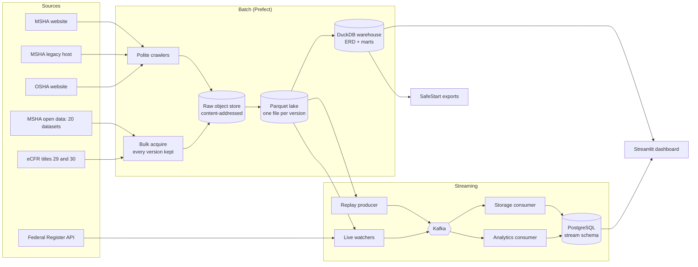

# Architecture

SafeStart's data pipeline collects the public U.S. mine and workplace safety record, keeps every version of it, and
serves two kinds of consumers: analysts (a DuckDB warehouse and its SQL marts) and a live dashboard fed by Kafka.

## Packages (`src/safestart_pipeline/`)

| Package | Role |
|---|---|
| `crawl/`, `acquire/` | Robots-compliant crawls of the three websites; bulk downloads of MSHA's open data and eCFR, every version kept |
| `lake/` | Typed Parquet of every version of MSHA's 20 datasets (`ssp lake`) |
| `warehouse/` | DuckDB warehouse built from the lake, the eCFR XML and the crawl catalogs; marts and documented queries |
| `stream/` | The event contract (`events.py`), PostgreSQL schema (`schema.sql`), Kafka clients, replay producer, storage and analytics consumers |
| `watch/` | Live watchers: new dataset versions (record diffs), website changes (sitemaps), Federal Register documents |
| `ml/` | Features from the lake with Polars and a mine accident-risk model |
| `dashboard/` | Streamlit app over the warehouse and the streaming store |
| `flows/` | Prefect flows that run and schedule all of the above |

## Settings (`config.py`)

`data_root()`, `postgres_url()`, `kafka_bootstrap()`, `warehouse_path()`, and `setting(name, default)`: the environment
variable `SAFESTART_<NAME>` wins, then `pipeline.local.toml`, then the default. Secrets come only from the environment.
Local Compose ports: PostgreSQL 15432, Kafka 19092.

## The event contract

`stream/events.py` defines one validated envelope for every event. Topics: `msha.enforcement` (kinds `inspection`,
`violation`, `accident`, `order_107a`, keyed by mine) and `safety.sources` (kinds `dataset_version`, `page_change`,
`regulation`, keyed by kind). `event_id` is `<kind>:<source key>`, so a replay or a repeated check is idempotent.
`mode` is `replay` (history pushed through the stream in source-time order) or `live` (found by a watcher).

Details by kind (JSON scalars only):

| Kind | Key | Details |
|---|---|---|
| `inspection` | event_no | `activity_code`, `activity`, `begin_date`, `end_date` |
| `violation` | violation_no | `event_no`, `cfr_section` (e.g. `75.400`), `part_section` (as cited, e.g. `56.14107(a)`), `sig_sub`, `likelihood`, `injury_illness`, `negligence`, `proposed_penalty` |
| `accident` | document_no | `degree_injury_cd`, `degree_injury`, `serious`, `classification`, `accident_type`, `no_injuries`, `days_lost` |
| `order_107a` | violation_no | `termination_date` |
| `dataset_version` | dataset + version | `dataset`, `version`, `previous_version`, `rows`, `new_rows` |
| `page_change` | url + lastmod | `site`, `url`, `lastmod`, `change` (`added`, `changed`, `dropped`) |
| `regulation` | document number | `agency`, `document_number`, `type`, `html_url`, `publication_date` |

A violation is serious when `sig_sub` is true (significant and substantial); an accident is serious when it was fatal
or caused lost or restricted work days.

## Stores

- PostgreSQL, schema `stream` (`stream/schema.sql`): `events` (one row per event, envelope in columns, details and
  source as JSON, Kafka position), `daily_counts`, `forecasts`, `source_checks`.
- DuckDB warehouse (`warehouse_path()`): built into a new file and swapped in, so readers never see a half-built
  warehouse. Core tables `mine`, `inspection`, `violation`, `accident`, `production_quarter`, `cfr_section`,
  `document`, `dataset_version`; marts as views. The ERD is in `docs/ERD.md`.

## Entry points

| Command | Does |
|---|---|
| `ssp lake` | Builds the Parquet lake |
| `python -m safestart_pipeline.warehouse build` | Builds the DuckDB warehouse |
| `python -m safestart_pipeline.stream.init` | Creates the Kafka topics and the PostgreSQL schema |
| `python -m safestart_pipeline.stream.replay` | Replays enforcement history through Kafka |
| `python -m safestart_pipeline.stream.storage` / `.analytics` | The two consumer groups |
| `python -m safestart_pipeline.watch` | Runs the live watchers on their schedules |
| `python -m safestart_pipeline.ml train` | Builds features and trains the accident-risk model |
| `streamlit run src/safestart_pipeline/dashboard/app.py` | The dashboard |

## Constraints

- The cloud host is an e2-medium (2 shared vCPUs, 4 GB): Kafka runs with a small heap, PostgreSQL with a small
  configuration, and batch work streams through files instead of holding whole datasets in memory.
- Every request to a website follows its robots.txt and pacing (reuse `crawl/robots.py`); a refusal is never worked
  around.
- Tests use small fixtures and temporary directories; they never write under the real data root.
