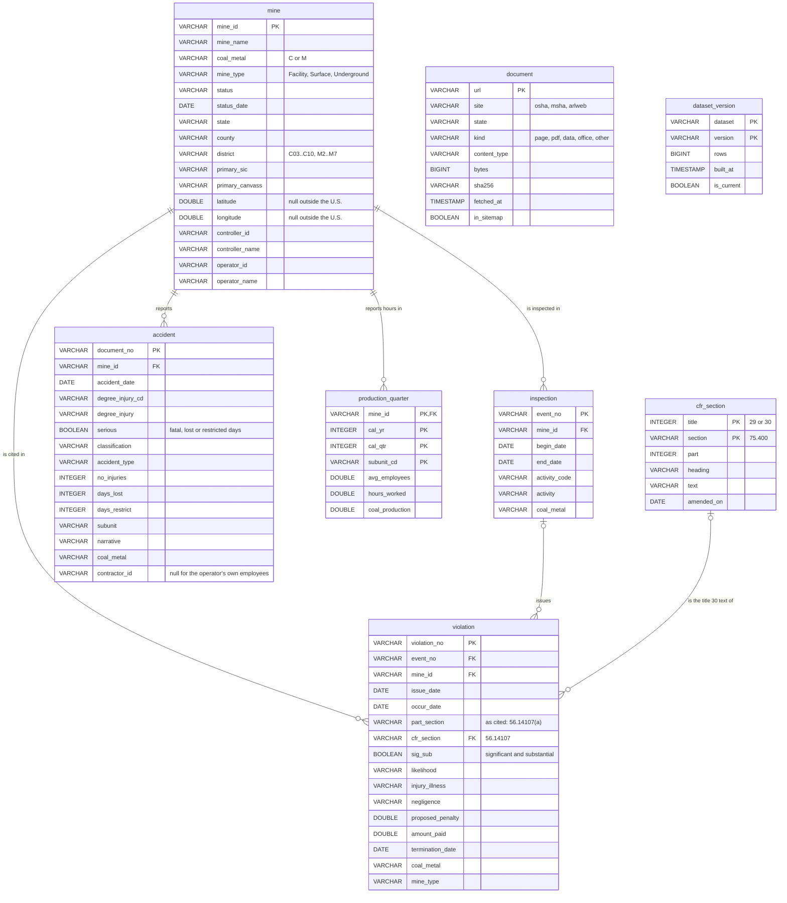

# Warehouse data model

The warehouse is one DuckDB file (`warehouse_path()`, `SAFESTART_WAREHOUSE_PATH`) built by
`python -m safestart_pipeline.warehouse build` from three read-only inputs: the current version of five lake datasets,
the govinfo eCFR XML of titles 29 and 30 in the bulk store, and the three crawl catalogs. The build writes
`<warehouse>.building` and renames it over the warehouse only when every step succeeded, so readers see the previous
warehouse or the new one, never a half-built file.

DuckDB rather than PostgreSQL holds the history because the questions are analytical scans over millions of rows on a
4 GB host: DuckDB streams the lake's Parquet through SQL without a server, and the real build (3.1 million violations,
2.8 million production rows) takes about 50 to 80 seconds with a peak working set of about 1 GB (the DuckDB memory
limit is `SAFESTART_WAREHOUSE_MEMORY_LIMIT`, default `1GB`). PostgreSQL keeps only the live event stream
(`stream/schema.sql`).

Keys are `PRIMARY KEY` constraints. The relationships are verified by the build and recorded in `build_check`, not
declared as foreign keys: one declared key would reject the 103 violations whose inspection is missing from MSHA's
inspection file, and the warehouse reports such rows instead of dropping them. `violation.cfr_section` joins
`cfr_section` on `title = 30 AND section = cfr_section` (MSHA cites title 30; see `cfr_section` below).

## Tables

Row counts are from the build of 2026-11-23 (lake versions built that day, violations through 2026-11-21).

### mine (92,129 rows)

One row per mine ever registered with MSHA, from the lake's `mines`. `coal_metal`, `mine_type`, `status`,
`status_date`, `county` (FIPS county name), `controller_*` and `operator_*` are the current values MSHA holds.
`latitude` and `longitude` are MSHA's text cast to numbers and kept only inside the U.S. and its territories as MSHA
writes them (latitude -15 to 72, longitude -180 to -60, every longitude negative, Guam's included); 478 of the 47,830
mines with coordinates hold typing errors (a longitude of -0.0003, a latitude of 90.99) and get nulls.

### inspection (1,165,876 rows)

One row per inspection or other enforcement event (`event_no`), from the lake's `inspections`. MSHA's file lists event
4165469 twice, once per controller; the warehouse keeps one copy (both are identical in these columns) and both are in
`duplicate_row`.

### violation (3,115,805 rows)

One row per citation or order, from the lake's `violations`. `cfr_section` is `part_section` without its paragraph
suffix: the leading `part.section` number with any `-n` suffix, which is a section of its own in the CFR
(`56.14107(a)` is `56.14107`, `75.1100-2(b)` is `75.1100-2`, the mistyped `77.403-ag` is `77.403`); 3,081,904 rows have
one, the rest cite no section. `sig_sub` is true for an S&S violation, false when the inspector marked it not S&S, and
null when no designation applies (48,534 rows, almost all orders and safeguards). MSHA's file lists 51 violations twice,
once per contest docket; the copies are identical in these columns, so one is kept and both are in `duplicate_row`.

### accident (276,013 rows)

One row per accident, injury or illness report (one person per report), from the lake's `accidents`. `serious` is
true when the accident was fatal or cost lost or restricted work days: degree of injury `01` (fatality), any
`days_lost` or `days_restrict`, or degree `03`, `04` or `05`, which mean days away from work or restricted activity even
before the day counts are filled in (160,872 rows). `contractor_id` goes beyond the warehouse contract: an injury rate
over the hours mine operators report must leave out contractors' employees, whose hours are reported separately.

### production_quarter (2,784,528 rows)

Employment, hours and coal production per mine, calendar quarter and subunit (underground, surface, mill, office ...),
from the lake's `mines_prod_quarterly` (2000 to 2026 Q3). The hours are those of the mine operator's employees.

### cfr_section (13,216 rows)

Every section of eCFR titles 29 (7,262) and 30 (5,954) from govinfo's XML, the edition named in `build_info`
(title 30 amended to 2026-11-12, title 29 to 2026-11-09). `section` is the number without the section sign (`75.400`,
a reserved range as `70.206-70.207`); `heading` is the HEAD without the number; `text` is the paragraphs, notes and
tables as plain text, one block per line, without the heading, the source note and eCFR's links to amendments not yet
in effect. `amended_on` is the latest Federal Register date in the section's source note (or, for a section without
one, in the nearest subpart or part source note): when its text last changed. `part` is null for the 31 sections of
title 29's lettered parts (1912a, 4022B, 4041A).

The key is `(title, section)`: 286 section numbers exist in both titles (29 CFR 1.1 and 30 CFR 1.1), so a number alone
does not identify a section. MSHA's citations are to title 30; 11 violations cite such a shared number (`7.7`).

### document (102,470 rows)

Every URL the three crawls learned of, from `state/crawl-{osha,msha,arlweb}.sqlite`, in whatever state it ended
(`fetched`, `unchanged`, `skipped`, `not_found`, `redirect`, `error`, or `pending`/`retry` while a crawl runs). `kind`
is derived from the URL with the crawler's own rule (`crawl/urls.py`): a known file extension makes `pdf`, `office`
(Word, Excel, PowerPoint, Visio), `data` (CSV, text, XML, JSON, archives, databases) or `other` (images, audio, video,
programs); anything else, such as `/standardnumber/1910/1910.1200`, is a `page`. `content_type` is the media type
without parameters; `bytes` is the recorded length; `sha256` names the stored copy.

### dataset_version (40 rows)

Every version of every one of the lake's 20 datasets, from the lake manifests: `version` is the Parquet file's name
(the first 16 hex digits of the source file's SHA-256), `rows` and `built_at` come from the manifest, and `is_current`
marks the version the lake serves (the one the warehouse was built from, for the five datasets above).

## Marts (views)

Views over the tables, so they always agree with them; each answers in under 0.2 seconds on the real warehouse.
"12m" is the 12 months up to the newest violation issue date in the data (here 2025-11-22 to 2026-11-21), not today's
date. An injury in a rate is a reportable injury (degree `01` to `06`) to a mine operator's employee, the people whose
hours `production_quarter` holds, and a rate pairs a quarter's injuries with the same quarter's hours.

| View | One row per | Columns |
|---|---|---|
| `mart_top_cited_sections` | cited section | `cfr_section`, its title 30 `heading` (null if not in today's CFR), `citations`, `ss_citations`, `ss_share`, `proposed_penalty_total`, `last_cited` |
| `mart_mine_scorecard` | mine | the mine's identity and location, `inspections_12m`, `violations_12m`, `ss_violations_12m`, `proposed_penalty_12m`, `accidents_12m`, `serious_accidents_12m`, `hours_worked_12m`, `injury_rate_12m` (per 200,000 hours, null without hours), `top_sections_12m` (up to five most cited sections, most cited first, `VARCHAR[]`) |
| `mart_ss_trend` | year and commodity | `violations`, `ss_violations`, `ss_share` (S&S share of all violations issued that year) |
| `mart_injury_rate` | year and commodity | `injuries`, `hours_worked`, `rate_per_200k`, counting only quarters with reported hours (the current year is partial) |
| `mart_district_year` | district and year | `inspections` (by begin date), `violations`, `ss_violations`, `accidents`, by the mine's district |

In the scorecard, `hours_worked_12m` and `injury_rate_12m` use the four latest quarters with reported hours that end by
the window's end (2025 Q4 to 2026 Q3 here), since hours are reported per quarter; the other counts use the 12m window.

## Build metadata

| Table | Holds |
|---|---|
| `build_info` | `built_at`, the format version, each eCFR title's SHA-256 and amendment date, the crawl catalogs read |
| `build_check` | every rule the build verified, with the rows it affected and a detail (below) |
| `duplicate_row` | every copy of every repeated key, as its full source row in JSON, the loaded copy flagged `kept` |

The checks of the 2026-11-23 build:

| Check | Rows | Detail |
|---|---:|---|
| `unique_key:<table>` | 1 (inspection), 51 (violation), 0 elsewhere | repeated keys; their copies are identical in the warehouse's columns |
| `reference:violation.event_no` | 103 | violations whose inspection is not in the inspection file (`6929559`, `F00332A` ...) |
| `reference:<table>.mine_id` | 0 | every mine referred to is in `mine` |
| `cited_section_not_in_title_30` | 5,040 | 103 cited numbers have no text in today's title 30 (`75.383`, `70.207`, `75.1101-23` ...) |
| `part_section_not_parsed` | 0 | every cited part/section starts with a section number |
| `section_number_in_both_titles` | 286 | numbers in titles 29 and 30; 11 violations cite one |
| `part_not_a_number` | 31 | sections of lettered parts |
| `mine_coordinates_dropped` | 478 | coordinates outside the U.S. and its territories |
