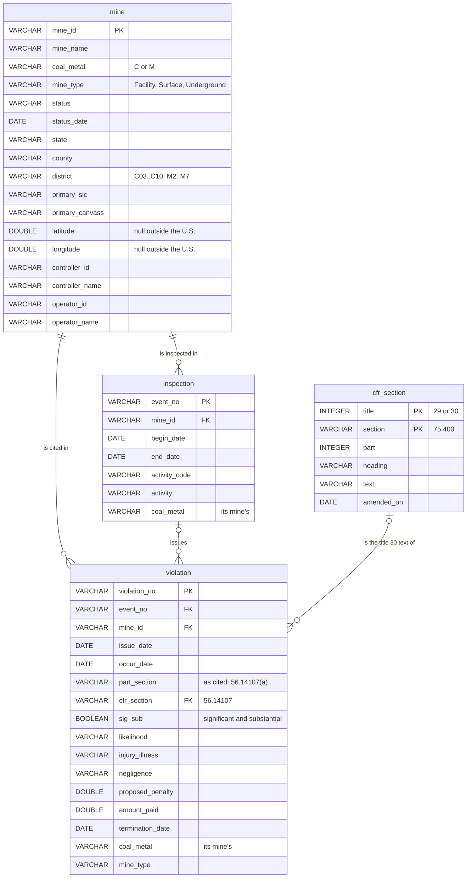
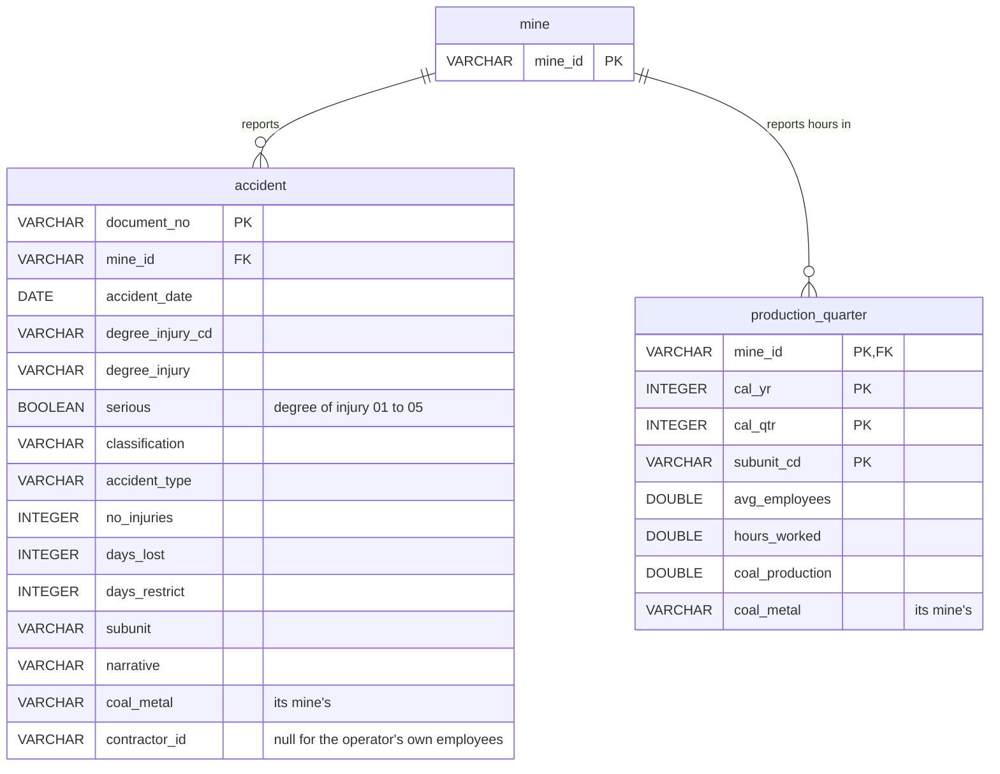
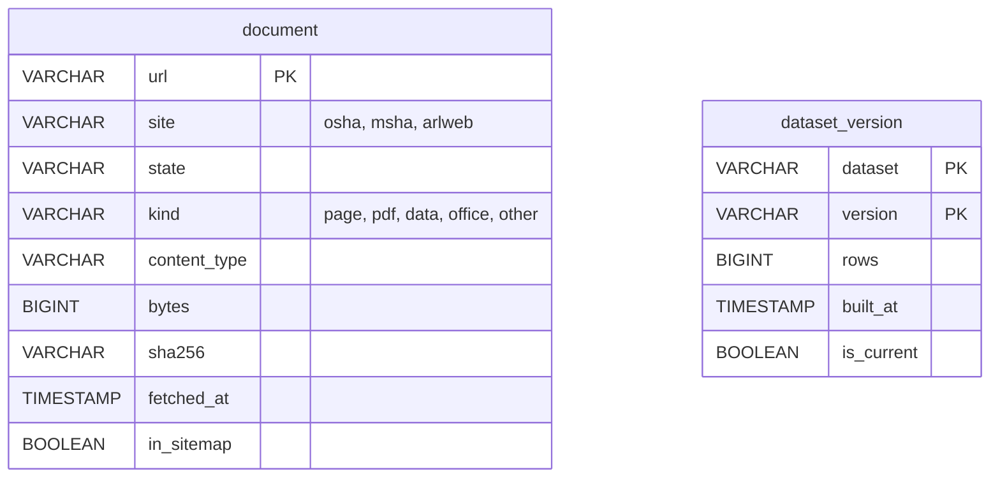
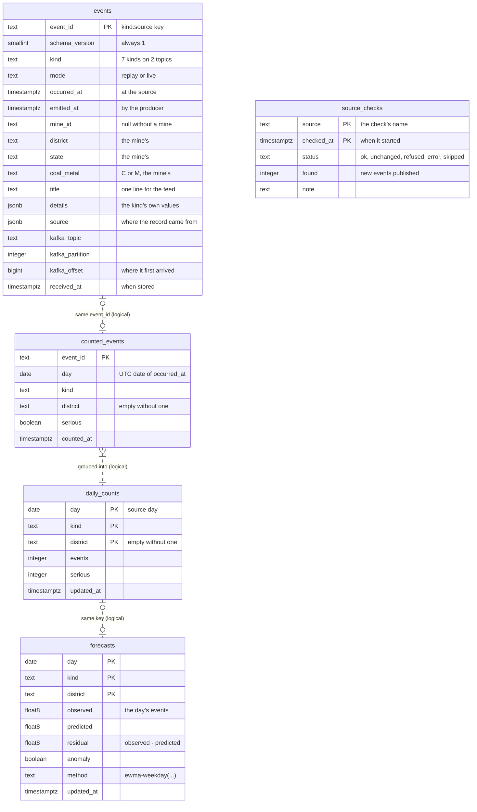

# Warehouse data model

The warehouse is one DuckDB file (`warehouse_path()`, `SAFESTART_WAREHOUSE_PATH`) built by
`python -m safestart_pipeline.warehouse build` from three read-only inputs: the current version of five lake datasets,
the verified govinfo eCFR XML of titles 29 and 30 the bulk store holds (a failed check of a title leaves the copy held
in use), and the three crawl catalogs. The build writes `<warehouse>.building` and renames it over the warehouse only
when every step succeeded, so readers see the previous warehouse or the new one, never a half-built file. Under the
warehouse's lock it first removes what a build killed without unwinding left behind: its `.building` file and its
staging folder `.<warehouse>-*` with DuckDB's spill files.

DuckDB rather than PostgreSQL holds the history because the questions are analytical scans over millions of rows on a
4 GB host: DuckDB streams the lake's Parquet through SQL without a server. The real build of 2026-11-23 (3.1 million
violations, 2.8 million production rows) took 27 seconds on a workstation with a peak working set of 1.1 GB (the
DuckDB memory limit is `SAFESTART_WAREHOUSE_MEMORY_LIMIT`, default `1GB`) and wrote a 639 MB file. PostgreSQL keeps
only the live event stream (`stream/schema.sql`).

The derived columns follow the definitions every component shares (`src/safestart_pipeline/definitions.py`), so the
warehouse, the stream, the model and the dashboard count the same things: an accident is serious when its degree of
injury is 01 to 05, an injury is degree 01 to 06, a violation's cited section is the section its citation names
without the paragraph, and the commodity (`coal_metal`) of an inspection, violation, accident or production report is
its mine's. The marts and the named queries are plain SQL, so the build stores the rules they apply as macros made from
the same definitions, `is_fatal(degree)` and `is_injury(degree)`; an analyst's own SQL can call them too.

The model is drawn in three diagrams, so that none is too wide to read: a mine's enforcement record and the
regulations it cites; a mine's accidents and hours worked (`mine` appears there with its key only); and the two tables
that link to no other.

Keys are `PRIMARY KEY` constraints. The relationships are verified by the build and recorded in `build_check`, not
declared as foreign keys: one declared key would reject the 103 violations whose inspection is missing from MSHA's
inspection file, and the warehouse reports such rows instead of dropping them. `violation.cfr_section` joins
`cfr_section` on `title = 30 AND section = cfr_section` (MSHA cites title 30; see `cfr_section` below).

## Tables

Row counts are from the build of 2026-11-23 (lake versions built that day, violations through 2026-11-21).

### mine (92,129 rows)

One row per mine ever registered with MSHA, from the lake's `mines`. `coal_metal`, `mine_type`, `status`,
`status_date`, `county` (FIPS county name), `controller_*` and `operator_*` are the current values MSHA holds.
`latitude` and `longitude` are MSHA's text cast to numbers and kept only inside the U.S. and its territories as MSHA
writes them (latitude -15 to 72, longitude -180 to -60, every longitude negative, Guam's included); 478 of the 47,830
mines with coordinates hold typing errors (a longitude of -0.0003, a latitude of 90.99) and get nulls.

### inspection (1,165,876 rows)

One row per inspection or other enforcement event (`event_no`), from the lake's `inspections`. MSHA's file lists event
4165469 twice, once per controller; the warehouse keeps one copy (both are identical in these columns) and both are in
`duplicate_row`. `coal_metal` is the mine's commodity, which every inspection's own flag matches.

### violation (3,115,805 rows)

One row per citation or order, from the lake's `violations`. `cfr_section` is the section the citation names, by the
shared rule: the leading `part.section` number with any `-n` suffix, which is a section of its own in the CFR, without
the paragraph (`56.14107(a)` is `56.14107`, `75.1100-2(b)` is `75.1100-2`, `56.5001(a)/.5005` is `56.5001`, the
mistyped `77.403-ag` is `77.403`); 3,081,904 rows have one, the rest cite no section. `sig_sub` is true for an S&S
violation, false when the inspector marked it not S&S, and null when no designation applies (48,534 rows, almost all
orders and safeguards). MSHA's file lists 51 violations twice, once per contest docket; the copies are identical in
these columns, so one is kept and both are in `duplicate_row`.

`coal_metal` is the mine's commodity, not the flag the violation carries: 89,673 violations carry the other one (67,619
flagged coal at metal and non-metal mines, 22,054 the reverse), almost all issued since 2019 (5,700 to 13,500 a year,
fewer than 200 a year before), and count under their mine's, so a mine's violations, accidents and hours share one
commodity.

### accident (276,013 rows)

One row per accident, injury or illness report (one person per report), from the lake's `accidents`. `serious` is
true when the degree of injury is `01` to `05`: a death, a permanent disability, or days away from work or of
restricted activity (157,657 rows). The day counts play no part: the degree is set when the accident is reported,
while the counts arrive once the miner is back at work, and counts also appear on illnesses and other cases that are
not injuries. Before the shared definitions the warehouse counted degree 01, 03, 04 or 05, or any report with lost or
restricted days (160,872 reports); against that rule this one adds 866 permanent disabilities (degree 02) without day
counts and leaves out 4,081 reports with counts (3,542 occupational illnesses, 430 natural causes, 47 non-employees, 6
other cases, 56 without a degree). `coal_metal` is the mine's commodity, which every accident's own flag matches.
`contractor_id` goes beyond the warehouse contract: an injury rate over the hours mine operators report must leave out
contractors' employees, whose hours are reported separately.

### production_quarter (2,784,528 rows)

Employment, hours and coal production per mine, calendar quarter and subunit (underground, surface, mill, office ...),
from the lake's `mines_prod_quarterly` (2000 to 2026 Q3). The hours are those of the mine operator's employees.
`coal_metal` goes beyond the contract too: the mine's commodity, so an injury rate divides a commodity's injuries by
the hours worked under the same commodity. 784 reports carry the other flag (766 flagged coal at metal and non-metal
mines, 18 the reverse) and count under their mine's.

### cfr_section (13,216 rows)

Every section of eCFR titles 29 (7,262) and 30 (5,954) from govinfo's XML, the edition named in `build_info`
(title 30 amended to 2026-11-12, title 29 to 2026-11-09). `section` is the number without the section sign (`75.400`,
a reserved range as `70.206-70.207`); `heading` is the HEAD without the number; `text` is the paragraphs, notes and
tables as plain text, one block per line, without the heading, the source note and eCFR's links to amendments not yet
in effect. `amended_on` is the latest Federal Register date in the section's source note (or, for a section without
one, in the nearest subpart or part source note): when its text last changed. `part` is null for the 31 sections of
title 29's lettered parts (1912a, 4022B, 4041A).

The key is `(title, section)`: 286 section numbers exist in both titles (29 CFR 1.1 and 30 CFR 1.1), so a number alone
does not identify a section. MSHA's citations are to title 30; 11 violations cite such a shared number (`7.7`).

### document (102,470 rows)

Every URL the three crawls learned of, from `state/crawl-{osha,msha,arlweb}.sqlite`, in whatever state it ended
(`fetched`, `unchanged`, `skipped`, `not_found`, `redirect`, `error`, or `pending`/`retry` while a crawl runs). `kind`
is derived from the URL with the crawler's own rule (`crawl/urls.py`): a known file extension makes `pdf`, `office`
(Word, Excel, PowerPoint, Visio), `data` (CSV, text, XML, JSON, archives, databases) or `other` (images, audio, video,
programs); anything else, such as `/standardnumber/1910/1910.1200`, is a `page`. `content_type` is the media type
without parameters; `bytes` is the recorded length; `sha256` names the stored copy.

### dataset_version (40 rows)

Every version of every one of the lake's 20 datasets, from the lake manifests: `version` is the Parquet file's name
(the first 16 hex digits of the source file's SHA-256), `rows` and `built_at` come from the manifest, and `is_current`
marks the version the lake serves (the one the warehouse was built from, for the five datasets above).

## Marts (views)

Views over the tables, so they always agree with them; each answers in under 0.2 seconds on the real warehouse.
"12m" is the 12 months up to the newest violation issue date in the data (here 2025-11-22 to 2026-11-21), not today's
date. An injury in a rate is an injury by the shared rule (`is_injury`, degree `01` to `06`) to a mine operator's
employee, the people whose hours `production_quarter` holds, and a rate pairs a quarter's injuries with the same
quarter's hours; a mine's own rate counts its injuries only in the quarters it reported hours for (below). A
commodity's violations, injuries and hours are those whose `coal_metal`, their mine's, is that commodity.

| View | One row per | Columns |
|---|---|---|
| `mart_top_cited_sections` | cited section | `cfr_section`, its title 30 `heading` (null if not in today's CFR), `citations`, `ss_citations`, `ss_share`, `proposed_penalty_total`, `last_cited` |
| `mart_mine_scorecard` | mine | the mine's identity and location, `inspections_12m`, `violations_12m`, `ss_violations_12m`, `proposed_penalty_12m`, `accidents_12m`, `serious_accidents_12m`, `hours_worked_12m`, `injury_rate_12m` (per 200,000 hours over the quarters the mine reported hours for, null without hours), `top_sections_12m` (up to five most cited sections, most cited first, `VARCHAR[]`) |
| `mart_ss_trend` | year and commodity | `violations`, `ss_violations`, `ss_share` (S&S share of all violations issued that year) |
| `mart_injury_rate` | year and commodity | `injuries`, `hours_worked`, `rate_per_200k`, counting only quarters with reported hours (the current year is partial) |
| `mart_district_year` | district and year | `inspections` (by begin date), `violations`, `ss_violations`, `accidents`, by the mine's district |

In the scorecard, `hours_worked_12m` and `injury_rate_12m` use the four latest quarters with reported hours that end by
the window's end (2025 Q4 to 2026 Q3 here), since hours are reported per quarter; the other counts use the 12m window.
A mine's injuries count only in those of the four quarters it reported hours (more than zero) for, so a report not yet
filed adds neither hours nor injuries. MSHA's file had no 2026 Q3 report yet from 501 mines that reported hours for
2026 Q2, and 25 of the 4,076 operator injuries of the four quarters, at 19 mines, fell in a quarter their mine had not
reported hours for; counted against the other quarters' hours, they had raised 16 of the 12,722 rates (Fort Knox Mine's
from 0.75 to 1.13, 21 Mining's from 0 to 54.54). `mart_injury_rate` pairs each quarter's operator injuries at every
mine with the quarter's reported hours, so its newest quarter also counts injuries at mines whose report has not
arrived (9 of the 1,143 in 2026 Q3).

## Build metadata

| Table | Holds |
|---|---|
| `build_info` | `built_at`, the format version (2 since the shared definitions), each eCFR title's SHA-256 and amendment date, the crawl catalogs read |
| `build_check` | every rule the build verified, with the rows it affected and a detail (below) |
| `duplicate_row` | every copy of every repeated key, as its full source row in JSON, the loaded copy flagged `kept` |
| `null_key_row` | every source row with a null key column (the lake turns MSHA's `?` and empty values into nulls), which no key can hold and so is not loaded, as its full source row in JSON; empty in this build |

The warehouse also holds the macros `is_fatal(degree)` and `is_injury(degree)`, the shared rules for plain SQL.

The checks of the 2026-11-23 build:

| Check | Rows | Detail |
|---|---:|---|
| `null_key:<table>` | 0 | rows with a null key column, left out of the table and kept in `null_key_row` |
| `unique_key:<table>` | 1 (inspection), 51 (violation), 0 elsewhere | repeated keys; their copies are identical in the warehouse's columns |
| `commodity_differs_from_mine:violation` | 89,673 | violations whose own flag is not their mine's (67,619 coal at metal and non-metal mines, 22,054 the reverse); they count under the mine's |
| `commodity_differs_from_mine:production_quarter` | 784 | production reports whose own flag is not their mine's (766 coal at metal and non-metal mines, 18 the reverse) |
| `commodity_differs_from_mine:<table>` | 0 (inspection, accident) | every inspection's and accident's own flag is its mine's |
| `reference:violation.event_no` | 103 | violations whose inspection is not in the inspection file (`6929559`, `F00332A` ...) |
| `reference:<table>.mine_id` | 0 | every mine referred to is in `mine` |
| `cited_section_not_in_title_30` | 5,040 | 103 cited numbers have no text in today's title 30 (`75.383`, `70.207`, `75.1101-23` ...) |
| `part_section_not_parsed` | 0 | every cited part/section starts with a section number |
| `section_number_in_both_titles` | 286 | numbers in titles 29 and 30; 11 violations cite one |
| `part_not_a_number` | 31 | sections of lettered parts |
| `mine_coordinates_dropped` | 478 | coordinates outside the U.S. and its territories |

## Stream store (PostgreSQL)

The stream store is the PostgreSQL schema `stream`, defined in `src/safestart_pipeline/stream/schema.sql` and applied
by `python -m safestart_pipeline.stream.init` before the stream services start (every statement is idempotent, so init
can run before each start). Two Kafka consumer groups and the watchers write it: the storage consumer (group
`safestart-storage`) writes `events`; the analytics consumer (group `safestart-analytics`) writes `counted_events`,
`daily_counts` and `forecasts`, one transaction per batch under an advisory lock; the watchers write `source_checks`
directly, one row per check. Each consumer commits its Kafka offsets only after its transaction and every write is
keyed, so an event that arrives again (a replay loop, a batch redelivered after a crash) is neither stored nor counted
twice. The dashboard reads every table but `counted_events`. docs/ARCHITECTURE.md describes the event contract, the
consumers and the watchers.

Keys are `PRIMARY KEY` constraints, and the schema declares no foreign keys: each dashed line is a logical link, kept
by the code that writes the tables, not by a constraint. Types are as `schema.sql` declares them, `double precision`
written as its alias `float8` (a type in the diagram is one word). CHECK constraints keep `schema_version` at 1,
`kind`, `mode`, `coal_metal` and `status` to the values this section names, and the counts `events`, `serious` and
`found` at zero or more.

- `events` and `counted_events` share `event_id`. Every valid event reaches both, but two consumer groups write them,
  each reading Kafka at its own pace, so either table can hold an event the other has not reached yet; a foreign key
  either way would make one consumer wait for the other.
- `daily_counts` is always `counted_events` grouped by `day`, `kind` and `district`: one statement writes a new event
  to the ledger and adds it to its group's count, so every count row has at least one ledger row behind it (the smoke
  test, `scripts/smoke_test.py`, deletes its own run's ledger and count rows together, in one transaction).
- `forecasts` has the key of `daily_counts`, `(day, kind, district)`, and a forecast's `observed` is that count row's
  `events`, or 0 when there is none: a series has a forecast for a day without events when the same weekday in the 26
  weeks before had some, and a count row has no forecast until its day is complete.
- `source_checks` links to no table: `found` counts the events a check published, but an event does not name the check
  that found it.

An enforcement event's `mine_id` is MSHA's mine ID, the warehouse's `mine.mine_id`, but the warehouse is another
database, so no key can tie them; the event carries its mine's district, state and commodity itself, so its readers
need no lookup.

### events

One row per valid event from either topic, `msha.enforcement` or `safety.sources`, stored once by its `event_id`
(`<kind>:<source key>`, fixed for a given source record): an event that arrives again leaves the row as it was first
stored, with the topic, partition and offset it first arrived at. The envelope has columns of its own; JSON holds only
what varies by kind: `details`, the kind's own values (JSON scalars, listed per kind in docs/ARCHITECTURE.md), and
`source`, where the record came from (names to strings, such as a replayed event's dataset, lake version and
`through`, the last source day of its pass). `kind` is an enforcement kind (`inspection`, `violation`, `accident`,
`order_107a`) or a source kind (`dataset_version`, `page_change`, `regulation`); `mode` is `replay` (history sent in
source-time order) or `live` (found by a watcher). `occurred_at` is when the record happened at the source (midnight
UTC for a record that carries only a date; the check's start for a dropped page or a page change without a lastmod),
`emitted_at` when the replay or a watcher made the event, and `received_at` when the storage consumer stored it.
`mine_id`, `district`, `state` and `coal_metal` are null for an event without a mine, every source event among them;
an enforcement event has its record's `mine_id` and takes the other three from that mine in the lake's current mines
dataset (`stream/records.py` gives the fallbacks for a mine the dataset lacks). The table is indexed by kind and source
time, by mine and source time, by arrival, and by mode and arrival, the last for the dashboard's Live page when it
shows one mode's newest events and arrivals (it shows both modes by default).

### counted_events

The analytics consumer's ledger: one row per event it has counted, written by the statement that adds the event to
`daily_counts`, so an event that arrives again is never counted twice. `day` is the event's source day, the UTC date of
its `occurred_at`; `district` is its district, or empty when it has none; `serious` is true for a violation with
`sig_sub` true or an accident with `serious` true, flags the producers set by the shared rules (`definitions.py`).
`counted_at` is when it was counted.

### daily_counts

Events per source day, kind and district, for every kind, the source kinds included (their district is empty):
`events` counts them and `serious` the serious ones. `updated_at` is when the row's count last moved. The dashboard's
Enforcement page charts the four enforcement kinds from it, by period and district.

### forecasts

The one-step-ahead forecast of each complete source day of a series (kind and district) that has events on that day or
in its history, method `ewma-weekday(alpha=0.1,weeks=26,k=3.0)`: `predicted` is an exponentially weighted average of
the same weekday's counts in the 26 weeks before (smoothing 0.1), `residual` is `observed` minus `predicted`, and
`anomaly` is true when |residual| exceeds three scales, judged only with four weeks of history or more (the scale is in
docs/ARCHITECTURE.md). A day is complete once every partition the consumer reads has moved past it or been read to its
end, and at least one has moved past it; while a replay pass runs, only replayed events move a partition. An event that
arrives for a day already forecast recomputes the forecasts that depend on that day, so each row is what
`daily_counts` alone gives: the PostgreSQL tests (`tests/test_stream_postgres.py`) recompute every forecast from
`daily_counts` and compare. `updated_at` is when the row's values last changed. The dashboard's Enforcement page shows
the enforcement kinds' forecasts and anomalies.

### source_checks

One row per check of a live source by a watcher (`python -m safestart_pipeline.watch`), stored when PostgreSQL is
reachable; the watcher's log keeps every check either way. `source` is the check's name: `versions` and
`sitemaps-msha` every 6 hours, `sitemaps-osha` once a day and `federal-register` every hour. `checked_at` is when the
check started; `status` is `ok` (new events found), `unchanged`, `refused` (the host would not serve the watcher, as
when it answers a sitemap's URL with an HTML page; the refusal is recorded, never worked around), `error` or `skipped`;
`found` is the number of new events it published; `note` says what the check found, or why it was refused, failed or
was skipped (such as OSHA's sitemaps read less than a day before, or a site's crawl running). The dashboard's
Sources page shows each source's newest check and the last day's checks, errors and events found.
